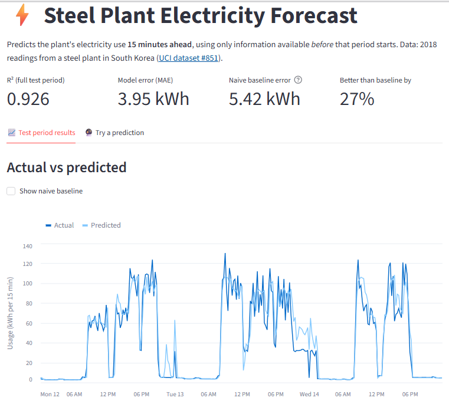

# Steel Plant Electricity Forecasting

Forecasts a steel plant's electricity use **15 minutes ahead**, using only information available before that period starts. Served as a **FastAPI** inference service with a **Streamlit** frontend.

**R² 0.926 · MAE 3.95 kWh · 27% lower error than a naive persistence baseline** (Random Forest, chronological hold-out of the last 30% of the year)

🔗 **[Live demo](https://steel-industry-energy-consumption.onrender.com/)** · **[API docs](https://steel-industry-energy-consumption-service.onrender.com/docs)**





## Why it matters

Manufacturers that can anticipate near-term electricity demand can schedule heavy loads more efficiently, manage peak-demand charges, and catch abnormal consumption early. That only works if the forecast uses data that actually exists at prediction time, so **forecast safety was the main design constraint** in this project.

## Highlights

- **Caught target leakage early.** `CO2(tCO2)` correlates with usage at r = 0.988 but has only 8 unique values, so it is derived from usage, not measured independently. Raw electrical readings from the same 15-minute window could rebuild the target almost exactly (R² ≈ 1.0). Both were excluded.
- **Evaluated like a forecast.** The train/test split is chronological, and every model is compared with a naive "same as the last reading" baseline, not just against other models.
- **Business KPIs, not only accuracy.** Error is checked by load type and by weekday vs. weekend, the views an operations team would use.
- **Production-style serving.** A FastAPI service builds the model's features from raw readings and serves predictions and evaluation results; the Streamlit app is a pure frontend that calls the API.

## Results

Three models were compared in scikit-learn pipelines, tuned with `GridSearchCV`, on a chronological split (first 70% of 2018 for training, last 30% for testing).

| Model | R² | MAE (kWh) | Improvement vs. naive baseline |
|---|---|---|---|
| Linear Regression | 0.885 | 6.27 | −15.7% (worse than baseline) |
| **Random Forest** | **0.926** | **3.95** | **27.1%** |
| XGBoost | 0.926 | 4.10 | 24.3% |

Naive baseline (predict the last reading): MAE 5.42 kWh.

### Business KPI check

| KPI | Target | Random Forest | XGBoost |
|---|---|---|---|
| R² | ≥ 0.75 | 0.926 ✅ | 0.926 ✅ |
| Improvement vs. naive baseline | ≥ 30% | 27.1% ❌ | 24.3% ❌ |
| MAE per load type ≤ 1.5 × overall MAE | all types | Light 1.20 ✅ · Medium 6.76 ❌ · Maximum 7.67 ❌ (limit 5.92) | Light 1.23 ✅ · Medium 6.92 ❌ · Maximum 8.13 ❌ (limit 6.15) |
| Weekday vs. weekend MAE gap | < 5 kWh | 3.06 ✅ | 3.25 ✅ |

**Random Forest is the recommended model**: it matches XGBoost on R² and beats it on every other KPI. It passes two of four targets. The misses are informative rather than hidden:

- **Medium and Maximum load periods are harder to forecast** because consumption swings sharply when heavy equipment starts and stops. Light-load periods are calm and make up 54% of the test set, which pulls the overall MAE down.
- **Beating persistence by 30% is ambitious at a 15-minute horizon**, where the last reading is already a strong predictor. `usage_lag_1` carries 82–87% of feature importance in both finalists.

## Dataset

[Steel Industry Energy Consumption](https://archive.ics.uci.edu/dataset/851/steel+industry+energy+consumption) (UCI #851): 35,040 readings at 15-minute intervals from a steel plant in Gwangyang, South Korea, during 2018. No missing values or duplicate rows.

## Features

The final, forecast-safe feature set:

- **Time of day:** sine/cosine encoding of seconds since midnight, so 23:45 and 00:00 sit next to each other, plus their interaction with load type.
- **Calendar:** weekend flag.
- **Recent usage:** usage 15 minutes and 1 hour earlier, and the mean and standard deviation of the previous hour.
- **Electrical load:** lagging reactive power × (100 − lagging power factor).

## API

| Endpoint | Purpose |
|---|---|
| `GET /health` | Health check |
| `GET /models` | Available models and their features |
| `POST /predict` | Forecast the next 15 minutes from raw readings |
| `GET /evaluation/summary` | Test-period KPIs for a model |
| `GET /evaluation/series` | Actual vs. predicted values for a date range |

Example request. The API builds the time, lag and rolling features itself:

```json
POST /predict
{
  "timestamp": "2018-11-12T10:00:00",
  "load_type": "Medium_Load",
  "recent_usage_kwh": [52.1, 49.8, 55.3, 51.0],
  "lagging_reactive_power_kvarh": 32.4,
  "lagging_power_factor": 78.5,
  "model": "random_forest"
}
```

## Run locally

```bash
git clone https://github.com/OctaviaMay/Steel-Industry-Energy-Consumption.git
cd Steel-Industry-Energy-Consumption
python -m venv .venv
source .venv/bin/activate        # .venv\Scripts\activate on Windows
```

**API** (terminal 1):

```bash
pip install -r api/requirements.txt
uvicorn api.main:app --reload
```

Interactive docs: http://127.0.0.1:8000/docs

**Streamlit app** (terminal 2):

```bash
pip install -r app/requirements.txt
streamlit run app/app.py
```

The app calls the API at `http://127.0.0.1:8000` by default. To use a deployed API, set `API_URL` in `.streamlit/secrets.toml` or as an environment variable.

**Notebooks** (analysis and training):

```bash
pip install -r requirements.txt
```

Run from `notebooks/` in order: `01_eda` → `02_feature_engineering` → `03_modeling` → `04_model_evaluation`.

## Project structure

```
├── api/                    FastAPI service: feature building, prediction, evaluation
├── app/                    Streamlit frontend (calls the API)
├── data/
│   ├── raw/                Original UCI CSV
│   ├── interim/            Cleaned, with parsed timestamps
│   ├── processed/          After feature engineering
│   └── split/              Held-out test set
├── models/                 Trained Random Forest and XGBoost pipelines
├── notebooks/              EDA, feature engineering, modeling, evaluation
└── src/
    ├── data/               Loading, validation, cleaning
    ├── features/           Feature engineering and leakage checks
    ├── models/             Training and evaluation
    └── visualization/      Plotting helpers
```

## Limitations and next steps

- **`electrical_load` uses readings from the same 15-minute window as the target.** Lagging it by one period is the fully forecast-safe choice; in a re-run this lowered R² only slightly (0.926 → 0.920, MAE 3.96 → 4.05), so the result holds.
- **Each day's 00:00 reading is stamped with the date of the day it closes** in the raw file. When sorted by timestamp, these 365 rows (about 1%) land at the start of the wrong day. Correcting them is a small, planned data fix.
- **Hyperparameter tuning uses standard k-fold cross-validation**; `TimeSeriesSplit` would better match the sequential data.
- **A day-ahead horizon** (forecasting 96 steps ahead) would be more useful for tariff and load scheduling, and is a natural extension.
- **Next:** unit tests for feature building and the API, and LightGBM/CatBoost comparisons.

## Tech stack

Python · pandas · NumPy · scikit-learn · XGBoost · FastAPI · Pydantic · Streamlit · Altair · Jupyter

## Author

Octavia May · [GitHub](https://github.com/OctaviaMay)

## License

© 2026 Octavia May. All rights reserved.

This code is shared publicly for portfolio review only. You may view it, but you may not copy, reuse, modify, or redistribute any part of it without my written permission. See [LICENSE](LICENSE) for details.
