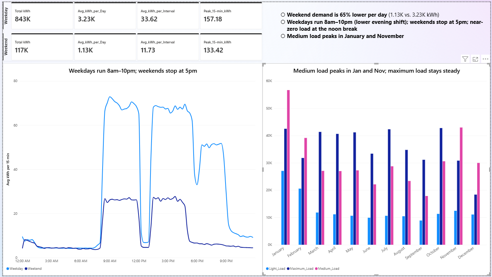
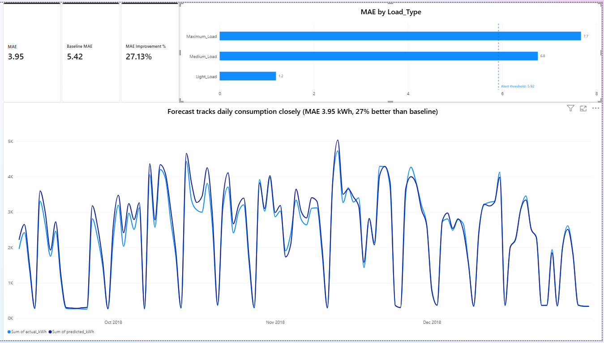

# Power BI: Steel Plant Energy Dashboard

**Page 1 – Operations:** KPIs by weekday/weekend, 15-min load profile, monthly kWh by load type.

**Page 2 - Model monitoring:** MAE 3.95 vs. 5.42 baseline (27% better); 
maximum and medium load exceed the 1.5× alert threshold

**Key findings**
- Weekend demand is 65% lower per day (1.13K vs. 3.23K kWh)
- Weekdays run 8am–10pm with a lower evening shift; weekends stop at 5pm
- Medium load peaks in January and November

Built with Power BI Desktop (Power Query, DAX measures). Open the `.pbix` in Power BI Desktop; data is embedded, refresh requires the source CSV.